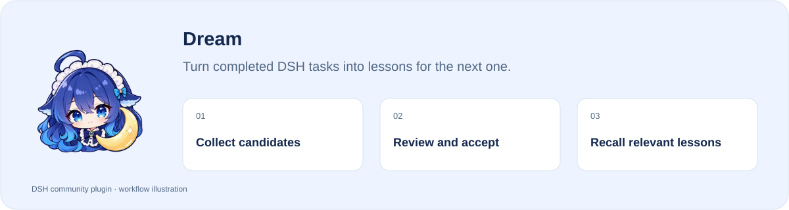
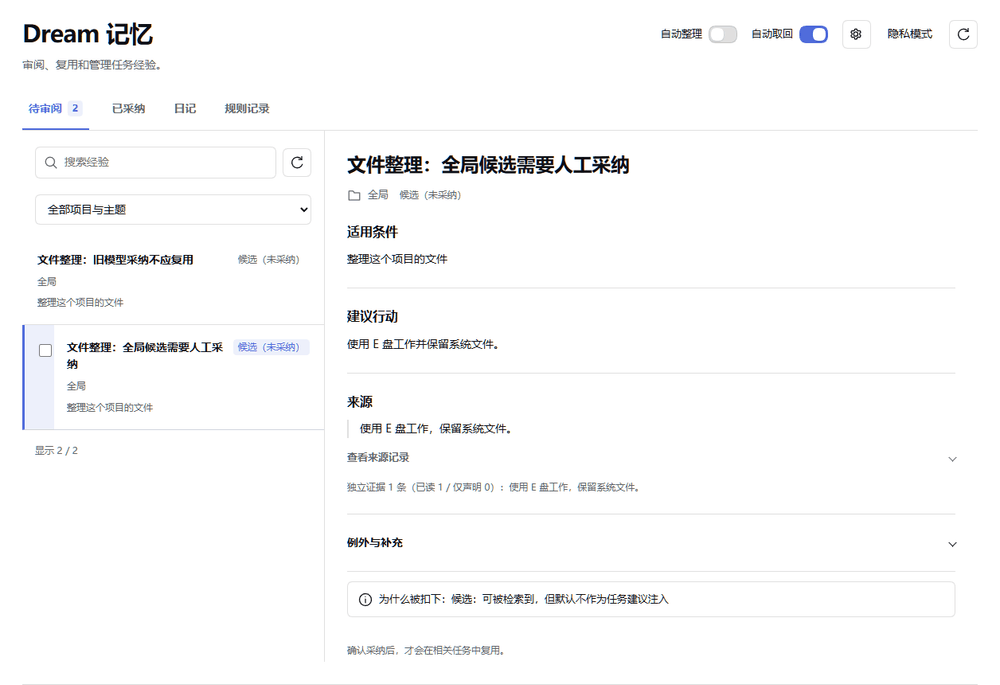

[简体中文](README.md) · **English**

# Dream

**Turn completed DSH tasks into lessons for the next one.**

[](https://www.npmjs.com/package/@stardustlc/dsh-dream) [](https://www.npmjs.com/package/@stardustlc/dsh-dream) [](https://www.npmjs.com/package/@stardustlc/dsh-dream)

**[Install](#install) · [Workflow](#start-using-it) · [Full guide](https://github.com/STARDUSTLC666/dsh-dream/blob/master/docs/REFERENCE.en.md)**

<picture>
  <source media="(prefers-color-scheme: dark) and (max-width: 640px)" srcset="https://raw.githubusercontent.com/STARDUSTLC666/dsh-dream/master/docs/assets/intro/workflow-en-mobile-dark.svg">
  <source media="(max-width: 640px)" srcset="https://raw.githubusercontent.com/STARDUSTLC666/dsh-dream/master/docs/assets/intro/workflow-en-mobile-light.svg">
  <source media="(prefers-color-scheme: dark)" srcset="https://raw.githubusercontent.com/STARDUSTLC666/dsh-dream/master/docs/assets/intro/workflow-en-dark.svg">
  
</picture>

## Features

- Collect candidates after real tasks, within your settings and limits.
- Inspect sources, scope, conditions and exceptions before accepting.
- Reuse accepted lessons in relevant tasks with source context.

## Review before reuse



A step carousel made from real validation screenshots (Chinese UI): inspect a candidate, then inspect the accepted list. This demonstrates manual review; it is not a continuous recording or a benchmark.

## Install

Open **Plugins** in the DSH desktop app and install `@stardustlc/dsh-dream`. If the CLI is available:

```bash
dsh plugin --profile desktop add @stardustlc/dsh-dream
```

For the web profile, replace `desktop` with `web`. Restart that DSH profile after installation. The package’s DSH requirement is `>=0.2.2-rc.3`.

## Start using it

1. Open Dream memory in the sidebar and choose whether to use automatic organization and recall.
2. Complete real work and check Pending review after an eligible task, or explicitly ask for a retrospective.
3. Expand a candidate, inspect sources, scope, conditions and exceptions, then decide whether to accept it.
4. Recall accepted experience in relevant tasks; edit, revoke or review it in Accepted when needed.

Example request：

> Review the task we just completed. Keep sources and place reusable lessons in the review queue.

## Before you start

Candidates are never automatically accepted. Collection uses the current chat’s model and quota; collection and recall have separate switches.

Configuration, detailed tools and troubleshooting: [full reference](https://github.com/STARDUSTLC666/dsh-dream/blob/master/docs/REFERENCE.en.md).

## Behind a reverse proxy

The panel routes accept loopback peers and localhost Hosts only, so a browser reaching DSH through a reverse proxy gets 403. Both allow-lists are empty by default and match exactly:

```yaml
# this plugin's config in cordis.patch.yml
trustedRemoteAddresses: ['192.0.2.10']         # example; replace with the proxy's own source address
trustedHosts: ['dsh.example.com']             # needed when the proxy preserves the public Host
```

`DSH_DREAM_TRUSTED_REMOTE_ADDRESSES` / `DSH_DREAM_TRUSTED_HOSTS` (comma separated) work too; config wins. The two gates are ANDed: an address-only entry still fails when the Host is a public name, and the 403 message names the missing piece. A listed peer is no longer held to loopback, so list only the proxy itself and keep an authentication layer in front of it.

## Plugin updates

Check updates at the bottom of the workbench or native plugin details. Automatic checks are on by default; **automatic installation is off**. You choose whether to install and when to restart. Suite-managed components update with their bundle. [Update behavior](https://github.com/STARDUSTLC666/dsh-dream/blob/master/docs/REFERENCE.en.md).

## Documentation

- [Full usage, configuration and limits](https://github.com/STARDUSTLC666/dsh-dream/blob/master/docs/REFERENCE.en.md)
- [Release notes](https://github.com/STARDUSTLC666/dsh-dream/blob/master/CHANGELOG.md)
- [Validation scope and history](https://github.com/STARDUSTLC666/dsh-dream/blob/master/docs/VALIDATION.md)

## Feedback and contributions

If the plugin helps, a Star makes it easier for others to discover. Report problems or suggest improvements in [Issues](https://github.com/STARDUSTLC666/dsh-dream/issues); code and documentation [PRs](https://github.com/STARDUSTLC666/dsh-dream/pulls) are welcome. Include versions and reproduction steps, and remove credentials from reports.

## License

[MIT](https://github.com/STARDUSTLC666/dsh-dream/blob/master/LICENSE)

<a id="what-it-does"></a>
<a id="requirements-and-configuration"></a>
