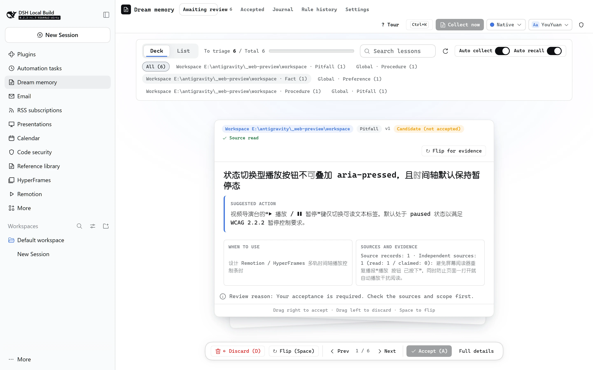

[简体中文](README.md) · **English**

# Dream

> **Turn completed DeepSeek Harness tasks into human-verified lessons ready for the next run.**

Native task-memory workbench for DeepSeek Harness (`>=0.2.2-rc.3`): opens in the **Tactile Triage Deck (`Deck`)** with 1-click classic `List` toggle, 13 bright styles × 8 fonts, and 8 UI locales.

[](https://www.npmjs.com/package/@stardustlc/dsh-dream) [](https://www.npmjs.com/package/@stardustlc/dsh-dream) [](https://www.npmjs.com/package/@stardustlc/dsh-dream)

**[Features](#features) · [Install](#install) · [Workflow](#start-using-it) · [Full guide](https://github.com/STARDUSTLC666/dsh-dream/blob/master/docs/REFERENCE.en.md)**

<picture>
  <source media="(prefers-color-scheme: dark) and (max-width: 640px)" srcset="https://raw.githubusercontent.com/STARDUSTLC666/dsh-dream/master/docs/assets/intro/workflow-en-mobile-dark.svg">
  <source media="(max-width: 640px)" srcset="https://raw.githubusercontent.com/STARDUSTLC666/dsh-dream/master/docs/assets/intro/workflow-en-mobile-light.svg">
  <source media="(prefers-color-scheme: dark)" srcset="https://raw.githubusercontent.com/STARDUSTLC666/dsh-dream/master/docs/assets/intro/workflow-en-dark.svg">
  
</picture>

## Features

| Pillar | Capabilities |
| :--- | :--- |
| **Tactile Triage Deck** | Review 3-deep candidate cards — drag right to accept / left to discard, press `Space` to 3D-flip for source evidence & secret redaction, Floating Action Dock (`D`/`Space`/`K·J`/`A`) & Inbox Zero progress; 1-click classic `List` view |
| **Evidence-First Review** | Candidates are never auto-accepted; inspect session quotes, scope, conditions, exceptions, and secret redaction masks before approving |
| **`AGENTS.md` Codify & Rollback** | Preview diffs before writing durable project conventions into `AGENTS.md`, with audit logs and 1-click rollback in **Rule history** |
| **Budgeted Collect & Recall** | Separate switches for idle collection and task-relevant recall within your configured model quota, plus an opt-in pre-completion verification gate (`enableVerificationGate`, off by default) |
| **Native Slash Commands** | Chat commands `/dream` (reflect/digest), `/dream-learn` (queue a candidate lesson), and `/dream-status` (inspect queue & host capabilities) while keeping the human-review boundary |
| **Locales & Synced UI** | 8 UI languages, command palette switching, `? Tour` spotlight guide, 13 bright styles & 8 fonts (style-matched font by default) |

## Review before reuse

[](docs/assets/intro/screen-en.webp)

*Captured with `Dream 0.19.0` running in Harness Web `0.2.2-rc.3` (Tactile Triage Deck + default YouYuan Mono font).*

## Install

Open **Plugins** in the DSH desktop app and install `@stardustlc/dsh-dream`, or use the CLI:

```bash
dsh plugin --profile desktop add @stardustlc/dsh-dream
```

For the web profile, replace `desktop` with `web` and restart DSH. Requires DSH `>=0.2.2-rc.3`.

## Start using it

1. **Accumulate naturally**: Open **Dream memory** in the sidebar and toggle **Auto collect** / **Auto recall**; idle turns queue qualifying candidates in **Awaiting review**.
2. **Distill on demand**: Click **Collect now**, or paste the 1-click prompt from `? Tour` into chat to replay recent sessions and extract source-backed candidates.
3. **Triage on the Deck**: Drag right to accept or left to discard, press `Space` to 3D-flip for verbatim quotes & redaction previews, or switch to **List** for batch review.
4. **Auto-recall & codify**: Approved lessons surface automatically in matching tasks; promote lasting rules to `AGENTS.md` with diff preview and 1-click rollback.

### Ready-to-copy prompts & native slash commands

- **Reflective journal**: `Have a dream` or `/dream [focus]` — replay recent sessions and record a reflection entry in **Journal** or inspect pending consolidation.
- **Distill lessons**: `Review our recent conversation and distill reusable project lessons` or `/dream-learn [lesson text]` — extract source-linked candidates into **Awaiting review**.
- **Check memory status**: `/dream-status` — view queue counts, observation metrics, and connected DSH native features.

## Before you start

- Candidates are never auto-accepted; auto-collection uses the current chat model and quota, and collection/recall switches are independent.
- Full configuration, tools, and troubleshooting: [full reference](https://github.com/STARDUSTLC666/dsh-dream/blob/master/docs/REFERENCE.en.md).

<details>
<summary>Behind a reverse proxy (only needed when accessing DSH via reverse proxy)</summary>

Panel routes default to loopback peers and localhost Hosts. To allow a reverse proxy (both gates are ANDed and exact-matched; env vars `DSH_DREAM_TRUSTED_REMOTE_ADDRESSES` / `DSH_DREAM_TRUSTED_HOSTS` also work, config wins):

```yaml
# this plugin's config in cordis.patch.yml
trustedRemoteAddresses: ['192.0.2.10']   # replace with the proxy's own source address
trustedHosts: ['dsh.example.com']        # needed when the proxy preserves the public Host
```

List only the proxy address itself and keep authentication in front of it.

</details>

## Plugin updates

Check updates at the bottom of the workbench or native plugin details. Automatic checks are on by default; **automatic installation is off**. Suite-managed components update with their bundle.

## Documentation & feedback

- [Full usage, configuration and limits](https://github.com/STARDUSTLC666/dsh-dream/blob/master/docs/REFERENCE.en.md) · [Release notes](https://github.com/STARDUSTLC666/dsh-dream/blob/master/CHANGELOG.md) · [Validation history](https://github.com/STARDUSTLC666/dsh-dream/blob/master/docs/VALIDATION.md)
- Stars, [Issues](https://github.com/STARDUSTLC666/dsh-dream/issues), and [PRs](https://github.com/STARDUSTLC666/dsh-dream/pulls) are welcome (strip credentials first).

## License

[MIT](https://github.com/STARDUSTLC666/dsh-dream/blob/master/LICENSE)

<a id="what-it-does"></a>
<a id="requirements-and-configuration"></a>
<a id="behind-a-reverse-proxy"></a>
