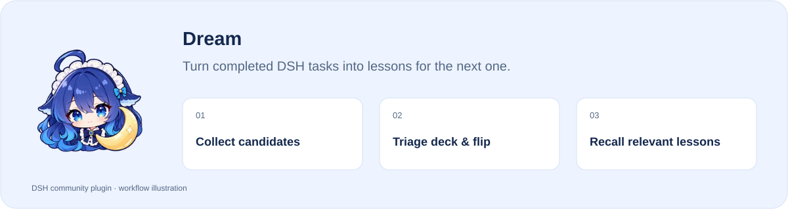

[简体中文](README.md) · **English**

# Dream

**DeepSeek Harness native task-memory plugin: turn completed DSH tasks into verified lessons for the next one.**

Built for DeepSeek Harness `>=0.2.2-rc.3`, featuring the bespoke **Tactile Triage Deck (`Deck`)** with 1-click toggle back to the classic `List` view, **13 switchable bright/soft workbench styles**, **8 dual-layer Chinese/Latin font pairings (default: YouYuan Mono)** synced across plugins, command palette quick switching, eight UI locales, and a soft-slate dark mode.

[](https://www.npmjs.com/package/@stardustlc/dsh-dream) [](https://www.npmjs.com/package/@stardustlc/dsh-dream) [](https://www.npmjs.com/package/@stardustlc/dsh-dream)

**[Install](#install) · [Workflow](#start-using-it) · [Full guide](https://github.com/STARDUSTLC666/dsh-dream/blob/master/docs/REFERENCE.en.md)**

<picture>
  <source media="(prefers-color-scheme: dark) and (max-width: 640px)" srcset="https://raw.githubusercontent.com/STARDUSTLC666/dsh-dream/master/docs/assets/intro/workflow-en-mobile-dark.svg">
  <source media="(max-width: 640px)" srcset="https://raw.githubusercontent.com/STARDUSTLC666/dsh-dream/master/docs/assets/intro/workflow-en-mobile-light.svg">
  <source media="(prefers-color-scheme: dark)" srcset="https://raw.githubusercontent.com/STARDUSTLC666/dsh-dream/master/docs/assets/intro/workflow-en-dark.svg">
  
</picture>

## Features

- Collect candidates after real tasks, within your settings and limits.
- **Tactile Triage Deck (`Deck` default)**: review candidates one card at a time on a 3-deep stack — drag right to accept / left to discard with live stamps & spring-back, press `Space` to 3D-flip for source evidence & secret redaction masks, use the Floating Action Dock (`D` / `Space` / `K·J` / `A` / `Full details`) with live Inbox Zero progress, or switch back to the classic `List` split view & batch review in 1 click.
- Inspect sources, scope, conditions, and exceptions before accepting or writing to `AGENTS.md`, then reuse accepted lessons automatically with masked source context and bridge audit logs.
- Switch live across **13 bright/soft workbench styles** (Native Airy, Warm Cream, Claude Warmth, Bright 8-Bit, Airy Mint, Daylight Glass, E-Ink Paper, Blueprint, Riso Zine, Retro 98, Song Xuan, Aqua Gloss, Gazette) and **8 dual-layer font pairings (default: YouYuan Mono)** with portaled overlay sync, interactive `? Tour` guidance, and DSH `>=0.2.2-rc.3` host primitives and frame clearances.

## Review before reuse

[](docs/assets/intro/screen-en.webp)

*Captured with `Dream 0.19.0` running in Harness Web `0.2.2-rc.3` (Tactile Triage Deck + default YouYuan Mono font). Drag or dock-triage cards, press `Space` to 3D-flip for source evidence, or click `? Tour` in the header for an interactive walkthrough.*

## Install

Open **Plugins** in the DSH desktop app and install `@stardustlc/dsh-dream`. If the CLI is available:

```bash
dsh plugin --profile desktop add @stardustlc/dsh-dream
```

For the web profile, replace `desktop` with `web`. Restart that DSH profile after installation. The package’s DSH requirement is `>=0.2.2-rc.3`.

## Start using it

Dream works best as a lightweight **Accumulate → Reflect & distill → Tactile deck triage → Auto-recall** loop (click **`? Tour`** in the topbar anytime for a spotlight walkthrough):

1. **Accumulate naturally**: Open **Dream memory** from the sidebar and toggle **Auto collect** and **Auto recall** right from the triage ribbon. Complete debugging or coding tasks as usual — idle turns queue qualifying candidates into **Awaiting review** with a live **Inbox Zero** progress bar.
2. **Reflect & distill on demand**: Click **Collect now** in the header to process queued turns immediately, or use the 1-click copy prompt buttons in the empty state / `? Tour` and paste into chat so the assistant replays recent sessions and distills source-backed candidates.
3. **Tactile deck triage (`Deck` default, 1-click back to `List`)**:
   - **Drag gesture**: Drag the active card right to accept or left to discard (releasing before the commit threshold springs smoothly back).
   - **3D evidence flip**: Press `Space` or click **↻ Flip for evidence** to 3D-flip the card and inspect exact session quotes, scope, exceptions, secret redaction masks, and revision/review diffs.
   - **Floating Action Dock**: Click or use keyboard shortcuts (`D` discard, `Space` flip, `K`/`J` prev/next, `A` accept) or open **Full details** to resolve conflicts and confirm global scope. Use the top **Deck / List** toggle anytime to return to the classic split list and batch review.
4. **Recall, codify & personalize**: Matching accepted lessons are recalled automatically in future tasks; durable project conventions can be diff-previewed before writing to `AGENTS.md`, with 1-click rollback in **Rule history**. Switch live across **13 bright styles** and **8 dual-layer fonts (`字`, default: YouYuan Mono)** synced across plugins, or tune budgets and 8 UI locales in **Settings**.

Handy chat prompts (1-click copyable in the workbench):

- `Have a dream` — replay recent sessions and record a reflection entry in **Journal**.
- `Review our recent conversation and distill reusable project lessons` — extract source-linked candidates into **Awaiting review**.

## Before you start

Candidates are never automatically accepted. Collection uses the current chat’s model and quota; collection and recall have separate switches.

Configuration, detailed tools and troubleshooting: [full reference](https://github.com/STARDUSTLC666/dsh-dream/blob/master/docs/REFERENCE.en.md).

## Behind a reverse proxy

The panel routes accept loopback peers and localhost Hosts only, so a browser reaching DSH through a reverse proxy gets 403. Both allow-lists are empty by default and match exactly:

```yaml
# this plugin's config in cordis.patch.yml
trustedRemoteAddresses: ['192.0.2.10']         # example; replace with the proxy's own source address
trustedHosts: ['dsh.example.com']             # needed when the proxy preserves the public Host
```

`DSH_DREAM_TRUSTED_REMOTE_ADDRESSES` / `DSH_DREAM_TRUSTED_HOSTS` (comma separated) work too; config wins. The two gates are ANDed: an address-only entry still fails when the Host is a public name, and the 403 message names the missing piece. A listed peer is no longer held to loopback, so list only the proxy itself and keep an authentication layer in front of it.

## Plugin updates

Check updates at the bottom of the workbench or native plugin details. Automatic checks are on by default; **automatic installation is off**. You choose whether to install and when to restart. Suite-managed components update with their bundle. [Update behavior](https://github.com/STARDUSTLC666/dsh-dream/blob/master/docs/REFERENCE.en.md).

## Documentation

- [Full usage, configuration and limits](https://github.com/STARDUSTLC666/dsh-dream/blob/master/docs/REFERENCE.en.md)
- [Release notes](https://github.com/STARDUSTLC666/dsh-dream/blob/master/CHANGELOG.md)
- [Validation scope and history](https://github.com/STARDUSTLC666/dsh-dream/blob/master/docs/VALIDATION.md)

## Feedback and contributions

If the plugin helps, a Star makes it easier for others to discover. Report problems or suggest improvements in [Issues](https://github.com/STARDUSTLC666/dsh-dream/issues); code and documentation [PRs](https://github.com/STARDUSTLC666/dsh-dream/pulls) are welcome. Include versions and reproduction steps, and remove credentials from reports.

## License

[MIT](https://github.com/STARDUSTLC666/dsh-dream/blob/master/LICENSE)

<a id="what-it-does"></a>
<a id="requirements-and-configuration"></a>
