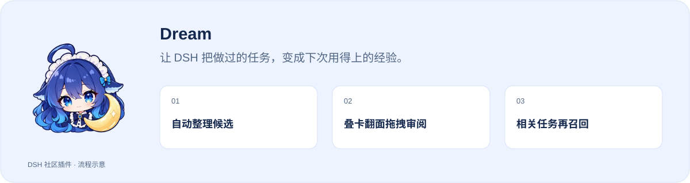
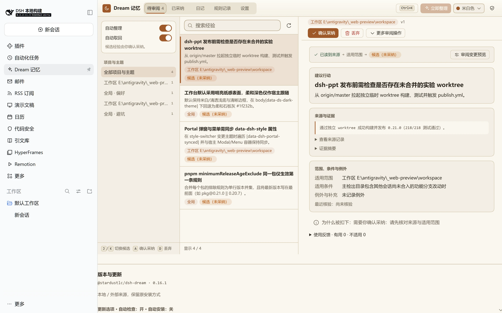

**简体中文** · [English](README.en.md)

# Dream

> **让 DeepSeek Harness 把做过的任务，沉淀为经过你核验、下次直接用得上的经验。**

原生任务经验记忆工作台（DSH `>=0.2.2-rc.3`）：默认 **「叠卡」触感分拣工作台**（1 键切经典列表），支持 13 套明亮风格、8 套双层字体与 8 种界面语言。

[](https://www.npmjs.com/package/@stardustlc/dsh-dream) [](https://www.npmjs.com/package/@stardustlc/dsh-dream) [](https://www.npmjs.com/package/@stardustlc/dsh-dream)

**[核心能力](#核心能力) · [安装](#安装) · [快速上手](#开始使用) · [完整说明](https://github.com/STARDUSTLC666/dsh-dream/blob/master/docs/REFERENCE.zh.md)**

<picture>
  <source media="(prefers-color-scheme: dark) and (max-width: 640px)" srcset="https://raw.githubusercontent.com/STARDUSTLC666/dsh-dream/master/docs/assets/intro/workflow-zh-mobile-dark.svg">
  <source media="(max-width: 640px)" srcset="https://raw.githubusercontent.com/STARDUSTLC666/dsh-dream/master/docs/assets/intro/workflow-zh-mobile-light.svg">
  <source media="(prefers-color-scheme: dark)" srcset="https://raw.githubusercontent.com/STARDUSTLC666/dsh-dream/master/docs/assets/intro/workflow-zh-dark.svg">
  
</picture>

## 核心能力

| 模块 | 核心特性 |
| :--- | :--- |
| **「叠卡」触感分拣台** | 3 层实体叠卡逐张审阅——右拖采纳 / 左拖丢弃、`Space` 3D 翻面核对原文与脱敏槽位、悬浮操作坞（`D`/`Space`/`K·J`/`A`）与 Inbox Zero 进度；1 键切回经典「列表」批量审阅 |
| **来源核验与安全脱敏** | 候选绝不自动采纳；逐条核对会话原文出处、适用范围、前提例外与密钥脱敏预览后再决定入库 |
| **`AGENTS.md` 写入与回滚** | 长期稳定的项目规范支持差异预览后写入 `AGENTS.md`，并在「规则记录」保留审计与一键回滚 |
| **按预算自动整理与召回** | 自动整理与自动取回分别可控，空闲时按预算收集候选，后续相关任务自动召回已采纳经验 |
| **多语言与跨插件外观** | 8 种界面语言、命令面板快切、`? 引导` 聚光灯导览、13 套明亮风格与 8 套双层字体（默认幼圆等宽） |

## 看看怎么用

[](docs/assets/intro/screen-zh.webp)

*截图来自 Harness Web `0.2.2-rc.3` 中运行的 `Dream 0.19.0`（叠卡工作台 + 默认幼圆等宽字体）。*

## 安装

在 DSH 桌面版「插件」面板安装 `@stardustlc/dsh-dream`，或使用命令行：

```bash
dsh plugin --profile desktop add @stardustlc/dsh-dream
```

网页版将 `desktop` 改为 `web`，安装后重启 DSH。宿主要求：`>=0.2.2-rc.3`。

## 开始使用

1. **日常积累**：打开左侧栏「Dream 记忆」，按需开启「自动整理」与「自动取回」；空闲时自动将任务复盘线索收入「待审阅」。
2. **主动做梦提炼**：点顶栏「立即整理」，或复制空态 / `? 引导` 中的指令发给助手，回放最近会话并生成反思日记与候选经验。
3. **叠卡分拣入库**：右拖采纳 / 左拖丢弃，按 `Space` 3D 翻面核对原文证据与脱敏预览，也可用底部操作坞或 1 键切回经典「列表」。
4. **自动召回与规范沉淀**：已采纳经验将在相关任务自动回用；稳定规则可预览差异后写入 `AGENTS.md` 并随时一键回滚。

### 常用对话示例

- **写反思日记**：`做个梦`（回放最近会话，生成独立梦境反思日记）
- **提炼项目经验**：`复盘最近的对话并提炼可复用的项目经验`（提取带证据与适用范围的候选送入「待审阅」）

## 开始前要知道

- 候选经验绝不会自动采纳；自动整理会使用当前会话模型与额度，两个自动开关可独立控制。
- 详细配置、工具与排错见 [完整说明](https://github.com/STARDUSTLC666/dsh-dream/blob/master/docs/REFERENCE.zh.md)。

<details>
<summary>反向代理部署配置（仅在浏览器经反向代理访问 DSH 时需要）</summary>

面板路由默认仅放行回环来源与本机 Host，经反代访问报 403 时需同时精确配置两项白名单（`cordis.patch.yml` 或环境变量 `DSH_DREAM_TRUSTED_REMOTE_ADDRESSES` / `DSH_DREAM_TRUSTED_HOSTS`，配置项优先）：

```yaml
# cordis.patch.yml 中本插件的 config
trustedRemoteAddresses: ['192.0.2.10']   # 替换为反代自身来源地址
trustedHosts: ['dsh.example.com']        # 浏览器访问域名（反代未改写 Host 时必填）
```

仅填反代自身地址，并在反代前置身份验证。

</details>

## 插件更新

在工作台或原生插件详情页底部检查更新。默认自动检查，**默认不自动安装**；Suite 管理的组件随整包更新。

## 文档与反馈

- [完整使用、配置与边界](https://github.com/STARDUSTLC666/dsh-dream/blob/master/docs/REFERENCE.zh.md) · [更新记录](https://github.com/STARDUSTLC666/dsh-dream/blob/master/CHANGELOG.md) · [验证历史](https://github.com/STARDUSTLC666/dsh-dream/blob/master/docs/VALIDATION.md)
- 欢迎 Star、提交 [Issues](https://github.com/STARDUSTLC666/dsh-dream/issues) 与 [PR](https://github.com/STARDUSTLC666/dsh-dream/pulls)（反馈请附版本与复现步骤，并移除凭据）。

## License

[MIT](https://github.com/STARDUSTLC666/dsh-dream/blob/master/LICENSE)

<a id="依赖与配置"></a>
<a id="反向代理部署"></a>
